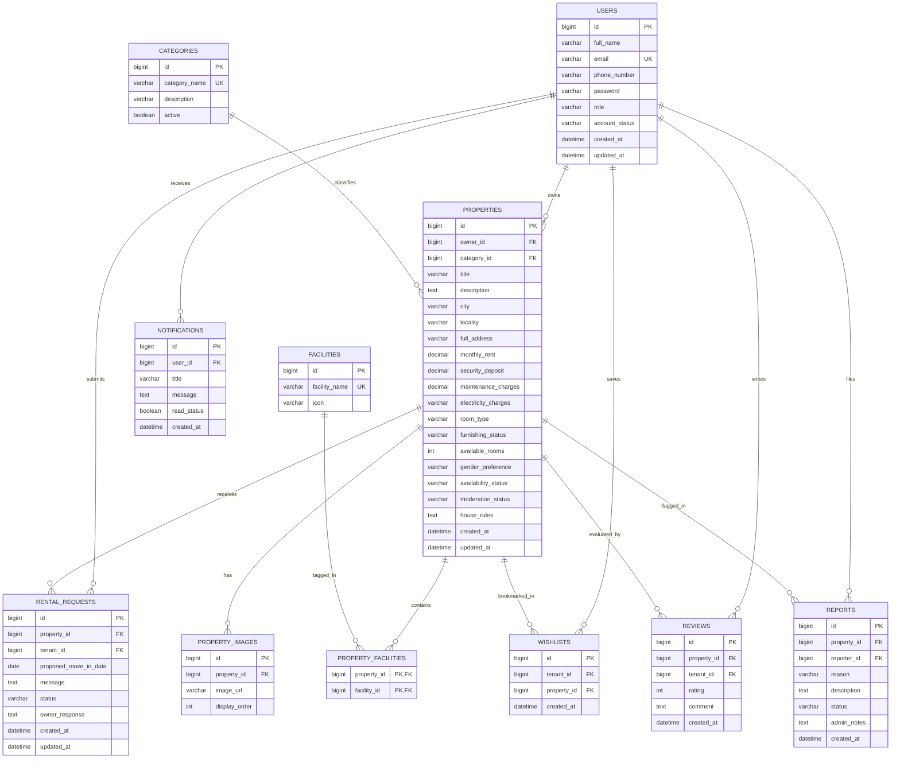

# Rental Rooms Management System - Database Design Documentation

## 1. Overview
The **Rental Rooms Management System** relational database is engineered on **MySQL 8.0+**, utilizing InnoDB engine for ACID compliance, referential integrity with foreign key cascades, and B-tree indexes for low-latency queries on searches, filters, and relationships.

---

## 2. Entity-Relationship Diagram

---

## 3. Detailed Table Specifications

### 3.1. `users`
- **Purpose**: Stores authentication credentials, contact details, account states, and security roles.
- **Constraints**:
  - `email`: UNIQUE constraint, non-null, lowercased.
  - `role`: Enum constraint (`ROLE_TENANT`, `ROLE_OWNER`, `ROLE_ADMIN`).
  - `account_status`: Enum constraint (`ACTIVE`, `INACTIVE`, `SUSPENDED`).
- **Indexes**: `idx_user_email` (B-tree), `idx_user_role` (B-tree).

### 3.2. `categories`
- **Purpose**: Classifies room configurations (`1 RK`, `1 BHK`, `2 BHK`, `Studio Apartment`, `Single Private Room`, `Shared Room`, `PG / Paying Guest`).
- **Constraints**:
  - `category_name`: UNIQUE constraint, non-null.

### 3.3. `facilities`
- **Purpose**: Amenity catalog (`High-Speed Wi-Fi`, `Air Conditioning`, `Attached Bathroom`, `Power Backup`, `Washing Machine`, `Kitchen Access`, etc.).
- **Constraints**:
  - `facility_name`: UNIQUE constraint.

### 3.4. `properties`
- **Purpose**: Core entity for rental room listings posted by landlords.
- **Constraints**:
  - `monthly_rent`: `CHECK (monthly_rent > 0)`.
  - `security_deposit`: `CHECK (security_deposit >= 0)`.
  - `available_rooms`: `CHECK (available_rooms >= 0)`.
  - Foreign key `owner_id` references `users(id)` ON DELETE CASCADE.
  - Foreign key `category_id` references `categories(id)` ON DELETE RESTRICT.
- **Indexes**:
  - `idx_property_city`, `idx_property_locality` for search queries.
  - `idx_property_rent` for price range filtering and sorting.
  - `idx_property_availability`, `idx_property_moderation` for active listing filters.

### 3.5. `property_images`
- **Purpose**: Multiple high-resolution images per room listing.
- **Constraints**:
  - Foreign key `property_id` references `properties(id)` ON DELETE CASCADE.

### 3.6. `property_facilities`
- **Purpose**: Many-to-many junction between properties and amenities.
- **Primary Key**: Composite `(property_id, facility_id)`.

### 3.7. `rental_requests`
- **Purpose**: Booking inquiries and tenancy negotiations.
- **Workflow States**: `PENDING` -> `ACCEPTED` / `REJECTED` / `CANCELLED` / `COMPLETED`.
- **Integrity Rule**: A tenant cannot create duplicate active requests on the same property.

### 3.8. `wishlists`
- **Purpose**: Bookmarked rooms for tenant dashboard.
- **Constraint**: `UNIQUE (tenant_id, property_id)` prevents duplicate bookmarks.

### 3.9. `reviews`
- **Purpose**: Verified tenant ratings and feedback.
- **Constraints**:
  - `rating`: `CHECK (rating BETWEEN 1 AND 5)`.
  - `UNIQUE (property_id, tenant_id)` enforces one review per tenant per property.

### 3.10. `notifications`
- **Purpose**: Real-time in-app alerts for status updates, new inquiries, and admin notices.

### 3.11. `reports`
- **Purpose**: Tenant complaints regarding suspicious, misleading, or inappropriate listings.
- **States**: `PENDING`, `INVESTIGATING`, `RESOLVED`, `DISMISSED`.
